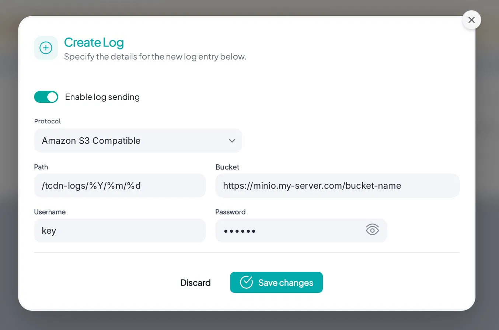

# Logs

With **Logs**, Transparent Edge sends the access logs of your sites to a server of your own, so you can store them, analyze them or feed them to your own tools. You choose where they go: an **FTP** or **SFTP** server, or **Amazon S3** (or any S3-compatible storage).

You'll find it under **Observability → Logs**.

Logs are sent in **batches**: they're collected, compressed and delivered every hour. If you need them in real time instead, see Streaming Logs.

Log shipping is included in all plans. It doesn't work on its own: you have to activate it and configure where the logs are sent.&#x20;

All the dates and times in the logs are recorded in **UTC**.&#x20;

### Enabling log shipping

The first time, the page is empty and shows **Enable Log Shipping**. Click it to add your first destination. Later, new destinations are added from the same page.

<figure><figcaption></figcaption></figure>

1. In the **Create Log** window, switch on **Enable log sending**.
2. Choose the **Protocol** you want to use: **FTP**, **SFTP** or **Amazon S3 Compatible**.
3.  Fill in the connection details. All the fields are required, and the window highlights any you leave empty.&#x20;


    **For FTP and SFTP:**

    | Field                        | What to enter                                                                          |
    | ---------------------------- | -------------------------------------------------------------------------------------- |
    | **Path**                     | The folder on your server where the logs will be stored (for example, `/path/to/log`). |
    | **FTP Host** / **SFTP Host** | The address of your server (for example, `ori.example.com`).                           |
    | **Port**                     | The port of your server.                                                               |
    | **Username**                 | The user Transparent Edge will use to connect.                                         |
    | **Password**                 | That user's password. Click the eye icon to see what you've typed.                     |


    **For Amazon S3 Compatible:**

    | Field        | What to enter                                                                             |
    | ------------ | ----------------------------------------------------------------------------------------- |
    | **Path**     | The folder inside the bucket where the logs will be stored (for example, `/path/to/log`). |
    | **Bucket**   | Your bucket (for example, `test-bucket`). See the notes below.                            |
    | **Username** | The access key.                                                                           |
    | **Password** | The secret key.                                                                           |
4. Click **Save changes**. **Discard** closes the window without saving anything.

Once the destination is active, the first delivery starts within the next hour after the FTP/SFTP connection has been activated and validated.

#### Sending logs to Amazon S3

To send the logs to Amazon S3 or to an S3-compatible storage, use an access key and a secret key whose policy allows, at least, uploading files to the bucket.

* **Bucket.** Write it as `<endpoint URL>/<bucket name>`. For Amazon S3 you can also use just the bucket name.
* **Path.** It accepts date placeholders: `%Y` (year), `%m` (month), `%d` (day) and `%H` (hour). For example, `/logs/%Y/%m/%d` stores the logs of February 20, 2023 in `/logs/2023/02/20`.

Don't repeat the bucket name inside the endpoint URL. Use `https://s3.us-east-1.amazonaws.com/my-bucket`, and not an address that already includes the bucket name in the domain. Otherwise, the bucket name is added again at the beginning of the path where the logs are stored.&#x20;

### The Logs page

The table lists your destinations:

| Column       | What it shows                                         |
| ------------ | ----------------------------------------------------- |
| **Host**     | The address of the server, with a copy button.        |
| **Port**     | The port used to connect.                             |
| **Active**   | The state of log sending: **Active** or **Inactive**. |
| **Protocol** | The protocol: for example, `ftp`.                     |
| **Path**     | The destination folder, with a copy button.           |
| **User**     | The username used to connect.                         |
| **Actions**  | **Test connection**, **Edit** and **Delete**.         |

#### Testing the connection

Click **Test connection** on a destination to check that Transparent Edge can connect to your server with the data you entered. If everything is right, you'll see the message _Connection successful_. It's a good idea to run it every time you create or change a destination.

#### Changing or pausing log sending

Click **Edit** to open the **Update Log** window. There you can change any of the details and click **Save changes**. To stop the delivery without losing your settings, switch off **Enable log sending**, and switch it on again when you want to resume it.

#### Deleting a destination

Click **Delete** to remove the destination; you'll be asked to confirm first. If you only want to stop the delivery for a while, switch off **Enable log sending** instead.

### What you receive

Each hour, Transparent Edge delivers compressed files (`.log.gz`). Usually there's one file for each edge node that served requests for your sites. The name follows this pattern:

```
<YYYYMMDDHH>-<CID>-<COUNTRY CODE>-<HASH>.log.gz
```

| Part           | Meaning                                                                |
| -------------- | ---------------------------------------------------------------------- |
| `YYYYMMDDHH`   | The date and hour (UTC) of the batch.                                  |
| `CID`          | Your company ID.                                                       |
| `COUNTRY CODE` | The country of the edge node.                                          |
| `HASH`         | An identifier of the edge node, useful for traceability and debugging. |

For example: `2023022010-4-spain-c7658c0dd514f6523f7a98ddd0dbb448.log.gz`.


Remember: anything you can do from the [dashboard](https://dashboard.transparentcdn.com/) can also be done through our [API](/broken/pages/-M8pmshPETdndon6vSV2).

