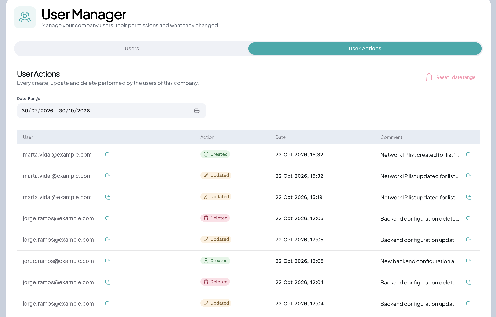

# User management

**User Manager** is where you control who can access the dashboard of your company and what each person can do there. You can create users, change their details and permissions, check whether they use two-factor authentication, close their open sessions and review what they have changed.

You'll find it under **Support → User Manager**.

The page has two tabs: **Users**, to manage the people in your company, and **User Actions**, to review their activity.

User Manager is meant for administrators. Users who don't have the right permissions (see Permissions) won't be able to manage other users.

### Users

The **Users** tab lists everyone who has access to your company. Above the list, the **Search by name or email** box helps you find someone quickly.

| Column                           | What it shows                                                                                                                       |
| -------------------------------- | ----------------------------------------------------------------------------------------------------------------------------------- |
| **ID**                           | The identifier of the user.                                                                                                         |
| **First Name** and **Last Name** | The name of the user.                                                                                                               |
| **Email**                        | The email the user signs in with, with a copy button.                                                                               |
| **2FA**                          | Whether the user has enabled two-factor authentication. Hover over the icon to see its state, for example _Two-factor not enabled_. |
| **Roles**                        | The permissions the user has, shown as labels (see Permissions).                                                                    |
| **Actions**                      | **User sessions**, **Edit** and **Delete**.                                                                                         |

#### Requiring two-factor authentication

At the top of the list, the **Require 2FA for every user** switch is a company-wide mandate. When it's on, every user of your company must enable two-factor authentication the next time they sign in, and can no longer turn it off in their own account.

#### Creating a user

1. Click **New User**, in the upper-right corner.
2. Fill in the user's details: email, first name, last name and an initial password.
3. Choose the user's permissions.
4. Save the user.

<figure><figcaption></figcaption></figure>

The new user receives an email with the information needed to access the dashboard, and can change the password later.

#### Editing a user

Click **Edit** to open the **Update User** page. There you can change:

* **First name** and **Last name**. The **Email** can't be changed after the user is created.
* The **Password**. Leave both password fields (**Password** and **Confirm password**) empty to keep the current one.
* The **Permissions** of the user.

Click **Save changes** to apply them, or **Discard** to leave without changes.

#### Closing a user's sessions

Click **User sessions** (the person icon) to see where the user is signed in right now. The **User Sessions** window lists each open session with its **User Agent**, **OS**, **IP**, **Country**, **City**, **ISP** and **Expiration**.

If a session looks suspicious or is no longer needed, revoke it from the **Actions** column: the user is signed out of that device immediately. If nobody is signed in, the window says _No active sessions_.

#### Deleting a user

Click **Delete** to remove a user and their access to the dashboard.

#### Permissions

Each user has one or more **roles** that decide which sections of the dashboard they can see and which actions they can perform. On the **Update User** page, the **Permissions** section shows all the available roles as cards, and how many of them are selected (for example, _2 of 13 selected_). You can type in **Filter roles** to find one.

Every user needs **at least one role**. A user without roles can't sign in.

**Company Administrator:** Full access to all company resources, settings, and user management.

**Invalidator:** Allows managing cache invalidation by URL or tag, as well as cache warmup operations.

**Statistics:** Read-only access to metrics dashboards and service performance data. Users with this role can consult analytics and historical data.

**Config Administrator:** Full configuration management of services: sites, backends, cache rules, DNS, SSL, autoprovisioning, and bot mitigation.

**Storage:** Manages storage buckets, their content, and consumption tracking.

**Transcoding:** Accesses and manages transcoding profiles, video jobs, processing queues, and consumed minutes.

**Log configuration:** Manages log configuration, storage destinations, and streaming setup.

**Staging:** Manages staging backends and autoprovisioning configurations.

**DNS Management:** Manages DNS zones, records, domains, hooks, and SSL certificates.

**Read-only access:** Read-only access to all company resources and configurations.

**IP list management:** Manages IP allow/deny lists, network blocks, address ranges, and notification preferences.

**Notifications only:** Manages notification preferences, alerts, and account security settings.

**User Administrator:** Allows creating and managing users within the company.

### User Actions

The **User Actions** tab keeps a record of every change the users of your company have made: everything that was created, updated or deleted.

1. Choose the **Date Range** you want to review. Click the field to pick the first and the last day in the calendar. By default it shows the last three months. **Reset date range** takes you back to it.
2.  Review the table:

    | Column      | What it shows                                    |
    | ----------- | ------------------------------------------------ |
    | **User**    | Who made the change, with a copy button.         |
    | **Action**  | What was done: for example, **Created**.         |
    | **Date**    | When it happened.                                |
    | **Comment** | A description of the change, with a copy button. |

At the bottom you can choose how many **rows per page** to show, see the number of records and the time of the last update, and set the **Auto-refresh** of the table. With the refresh set to 0 seconds, the table isn't updated automatically.

<figure><figcaption></figcaption></figure>

If there's no activity in the dates you chose, the page asks you to widen the date range. If the list can't be loaded, you'll see _Couldn't load data_, and **Try again** reloads it.
